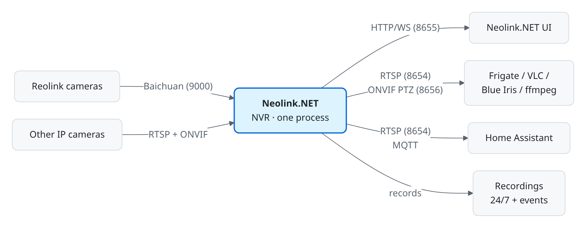
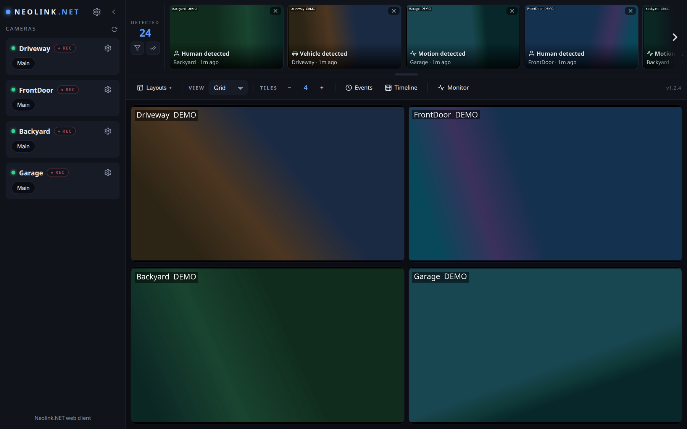
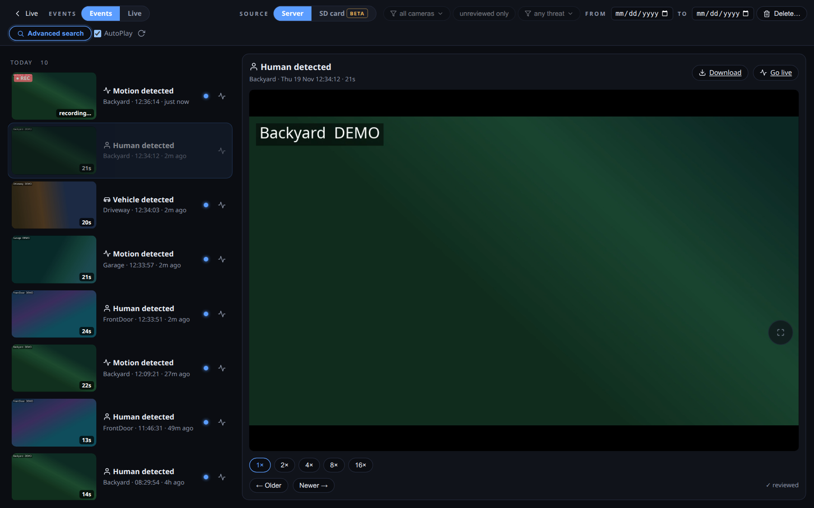
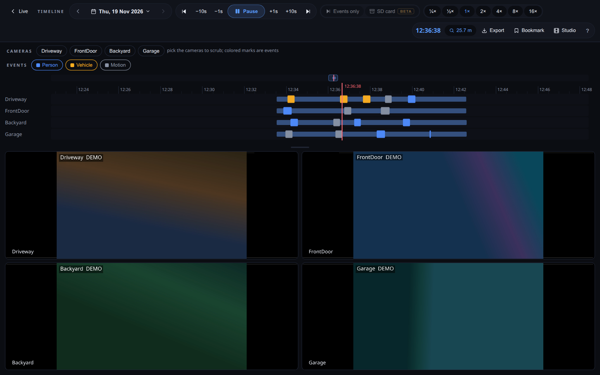
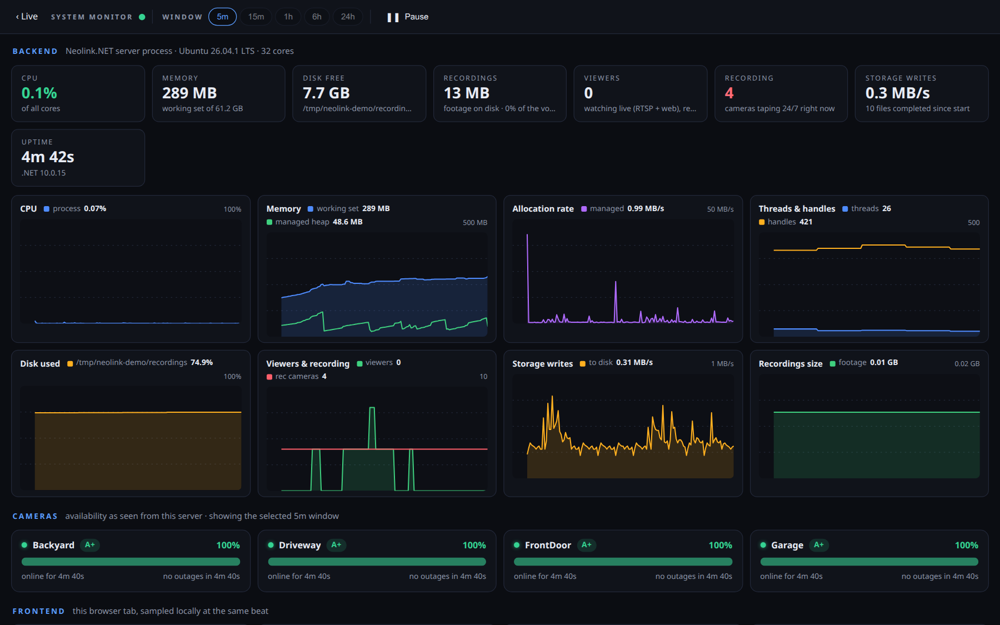
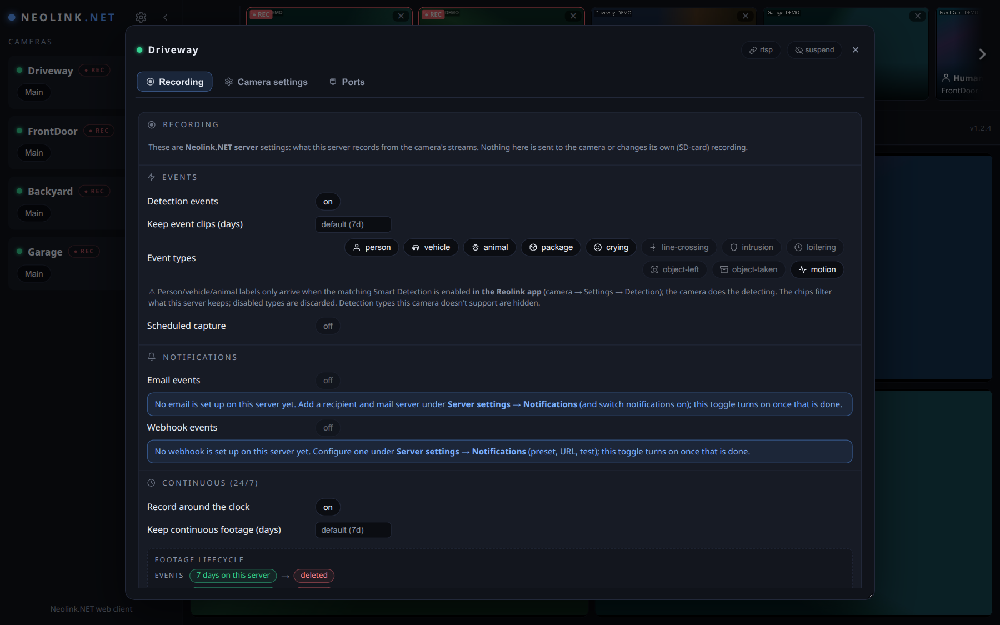
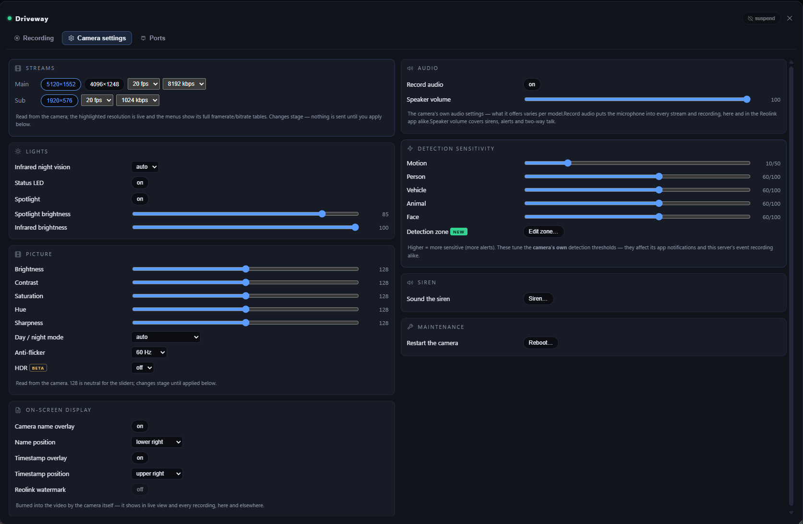

# Neolink.NET

**English** · [Français](docs/translations/README.fr.md) · [Deutsch](docs/translations/README.de.md) · [Español](docs/translations/README.es.md) · [Nederlands](docs/translations/README.nl.md) · [Polski](docs/translations/README.pl.md) · [Português](docs/translations/README.pt.md)

**RTSP bridge, web viewer and NVR for Reolink cameras that speak the proprietary Baichuan protocol, and for any other camera that serves RTSP.**

Neolink.NET is built for Reolink IP cameras that talk the proprietary "Baichuan" protocol on
TCP port 9000 instead of standard RTSP/ONVIF (B800/D800, B400/D400, E1, Lumus, 510A,
Duo, TrackMix, Argus Solar, Solar Floodlight, and many others). Other IP cameras sit
beside them: Neolink.NET pulls their RTSP streams and reads their settings and
detections over ONVIF ([non-Reolink cameras](docs/generic-cameras.md#non-reolink-cameras-generic-rtsp)).

Your NVR software (**Frigate**, Blue Iris, Home Assistant, Shinobi, VLC, ffmpeg, …) connects to
Neolink.NET, which logs into the camera, demuxes its media stream, and re-serves it as
standards-compliant RTSP. On top of that, Neolink.NET ships a **built-in browser UI**:
a multi-camera wall with live low-latency video, no plugins, no transcoding and no GStreamer.
It also has a native **MQTT integration for Home Assistant**: each camera appears in HA
automatically (via MQTT Discovery) with motion/person/vehicle/animal sensors, controls,
and availability, driven by the camera's own detections.

It is also an **NVR in its own right**: it records detection events and continuous 24/7
footage to your own disks, and plays them back from an events page and a synced
multi-camera timeline with export. Retention, tiered storage and footage encryption are
built in, so no other recording software is needed.

The cameras are unmodified and no Reolink NVR is required.

<picture>
  <source media="(prefers-color-scheme: dark)" srcset="docs/architecture-dark.png">
  
</picture>



<table>
  <tr>
    <td width="20%"><a href="docs/screenshot-2.png"></a><br><sub><b>Events page</b>: deep-linkable review, filters, 1–16× playback</sub></td>
    <td width="20%"><a href="docs/screenshot-3.png"></a><br><sub><b>Timeline</b>: synced scrubbing, event marks, export</sub></td>
    <td width="20%"><a href="docs/screenshot-4.png"></a><br><sub><b>Monitor</b>: server health, camera uptime, fill forecasts</sub></td>
    <td width="20%"><a href="docs/screenshot-5.png"></a><br><sub><b>Recording setup</b>: events, 24/7, lifecycle, per camera</sub></td>
    <td width="20%"><a href="docs/camera-settings-2.png"></a><br><sub><b>Camera settings</b>: staged changes, applied only when you say so</sub></td>
  </tr>
</table>

*All screenshots show synthetic demo footage.*

> **Camera coverage.** Reolink's range is large and its firmwares differ. Neolink.NET is
> developed and tested on the handful of cameras I own. Other models should work, but I
> cannot promise it until someone with that hardware reports back. An issue with logs
> helps, and a pull request validated on your hardware helps most.

## Try it first: no cameras, no config

```bash
docker run --rm -p 8655:8655 ghcr.io/borexola/neolink.net:latest --demo
```

Open <http://localhost:8655> and you're looking at the real product with a fake
world behind it: **four synthetic cameras** with live moving video, detections
firing every minute or two, a seeded event history, 24/7 recordings scrubbing
on the timeline. No real footage anywhere, nothing saved: the demo world
lives in a temp folder, resets itself every six hours, and vanishes with the
container. The same showroom runs on bare metal too: `neolink.net --demo`
(needs ffmpeg on PATH).

## Quick start (Home Assistant add-on)

[](https://my.home-assistant.io/redirect/supervisor_add_addon_repository/?repository_url=https%3A%2F%2Fgithub.com%2Fborexola%2Fneolink.net)

1. Click the badge (or Settings → Add-ons → Add-on Store → ⋮ → Repositories →
   add `https://github.com/borexola/neolink.net`), then install **Neolink.NET**.
2. Add your cameras in the add-on's *Configuration* tab (name, IP, account).
3. Start it and click **OPEN WEB UI**.

With the **Mosquitto broker** add-on installed, cameras appear as Home Assistant devices
with no further setup. UDP-only battery cameras need the **Neolink.NET (host network)**
add-on from the same store instead. More in the
[add-on guide](docs/home-assistant.md#quick-start-home-assistant-add-on).

## Quick start (Docker, recommended)

> ### 📖 Full guide: **[docs/docker-install.md](docs/docker-install.md)**: image
> tags, docker compose, Unraid template, upgrading, building the image yourself.

```bash
mkdir -p config
docker run -d --name neolink --restart unless-stopped \
    -p 8654:8654 -p 8655:8655 \
    -e TZ=Europe/London \
    -v "$PWD/config:/config" \
    ghcr.io/borexola/neolink.net:latest
```

First start writes a commented starter config into `config/` and opens the
**web UI at <http://localhost:8655>**. Add your cameras under Server settings
(the gear icon) with the same login you use in the Reolink app, restart, and
streams serve at `rtsp://localhost:8654/<camera-name>`. Images are multi-arch
(`amd64` + `arm64`: x86 servers, Raspberry Pi 4/5, ARM NAS); pin a version tag
like `:1.0.1` in production.

> Host networking (`--network host`) is required for
> [UDP-only battery cameras](docs/battery-cameras.md#udp-only-models) and RTSP over UDP
> transport; everything else works with plain port mapping.

## Other ways to run it

- **Windows, no Docker:** one MSI installs the desktop app (beta) and, if you tick
  **Local server (Windows service)**, the full server too.
  [Step-by-step guide](docs/windows-install.md).
- **Unraid:** [template and notes](unraid/README.md).
- **From source:** needs the .NET 10 SDK.
  [Build and run it](docs/development.md#quick-start-from-source).

## Highlights

- **RTSP bridge:** H.264/H.265 and AAC are repackaged, never re-encoded, and one camera
  connection feeds any number of clients.
- **Web UI built in:** a multi-camera wall with sub-second live video, audio and opt-in
  two-way talk, with no plugins and no transcoding.
- **Camera settings and controls** read from the camera itself: PTZ, zoom, lights, siren,
  privacy mode, picture settings and more.
- **A full NVR:** detection-event clips and continuous 24/7 recording, an events page, a
  synced multi-camera timeline with export, retention, tiered storage and encryption at rest.
- **Home Assistant over MQTT:** a device per camera appears automatically, with detection
  sensors, controls and battery state.
- **Non-Reolink cameras:** any camera that serves RTSP, with settings and detections over ONVIF.
- **Frigate:** steady RTSP for detect and record, PTZ buttons, click-to-move and
  autotracking (beta).
- **Battery cameras (beta):** auto-detected and sleep-friendly, UDP-only Argus models included.
- **AI event descriptions and AI search (beta):** a vision LLM describes each event and
  rates its threat level.
- **Alerts:** email for critical conditions, plus per-user browser alerts.
- **Windows desktop app (beta):** the camera wall in its own window, with real Windows
  notifications.
- **Light on the server:** detection runs on the camera, so there is no GPU and no
  per-frame work. It runs on a Raspberry Pi.
- **Seven languages:** English, French, German, Spanish, Dutch, Polish and Portuguese.

The full list is in [docs/features.md](docs/features.md).

## Stream URLs

| URL | Content |
|---|---|
| `rtsp://host:8654/driveway` | main stream (alias) |
| `rtsp://host:8654/driveway/mainStream` | main stream (high resolution) |
| `rtsp://host:8654/driveway/subStream` | sub stream (low resolution) |
| `http://host:8655/` | web UI |

The Opus audio variant, the HTTP and WebSocket API, the ONVIF audio backchannel and WebRTC
in Home Assistant are in [docs/streams.md](docs/streams.md).

## Documentation

**Install**

- [Docker](docs/docker-install.md): image tags, compose, Unraid, upgrading
- [Home Assistant add-on](docs/home-assistant.md#quick-start-home-assistant-add-on)
- [Windows](docs/windows-install.md) and the [desktop app](docs/desktop-app.md) (beta)
- [From source](docs/development.md#quick-start-from-source)

**Configure**

- [Configuration reference](docs/configuration.md): every option, web UI sign-in, finding
  cameras, dual-lens cameras, detection zones
- [Non-Reolink cameras](docs/generic-cameras.md): generic RTSP, with settings over ONVIF
- [Recording (NVR)](docs/recording.md): event and 24/7 recording, retention, tiered storage,
  encryption
- [Battery cameras](docs/battery-cameras.md) (beta), UDP-only models included
- [Behind a reverse proxy](docs/reverse-proxy.md)
- [Email notifications](docs/email-notifications.md)

**Use**

- [Web UI tour](docs/web-ui.md)
- [Stream URLs and API](docs/streams.md)
- [AI event descriptions and AI search](docs/ai-descriptions.md) (beta)

**Integrate**

- [Home Assistant (MQTT)](docs/home-assistant.md)
- [Frigate](docs/frigate.md): streams, PTZ buttons, and
  [click-to-move and autotracking](docs/autotracking.md) (beta)

**Reference**

- [Features in full](docs/features.md)
- [Troubleshooting](docs/troubleshooting.md)
- [Development, self-tests and releases](docs/development.md)
- [Changelog](CHANGELOG.md)

## Project status & disclaimer

Neolink.NET is a personal project. I built it for my own use because the existing
options did not fully meet my needs, and I publish it in the hope that it is useful
to others in the same situation.

It is developed and validated on the cameras I personally own, a small slice of
Reolink's range. Firmware behavior varies meaningfully between models (see the camera coverage
note at the top), and I cannot buy every camera to test against;
reports with logs, and especially pull requests validated on hardware I do not
have, are the most effective way to get a model-specific problem fixed.

**It is provided "as is", without warranty of any kind**: no guarantee of
correctness, reliability, security, or fitness for a particular purpose, and no
commitment to support, maintenance, or timely fixes. Evaluate it against your own
requirements before depending on it, particularly where security footage or
around-the-clock monitoring matters. Issues and pull requests are welcome and
handled on a best-effort basis. The [license](LICENSE) contains the formal
warranty and liability disclaimers.

## Sponsorship

If Neolink.NET saves you or your business time, sponsorship funds the hours and the
hardware that keep it moving. Buying cameras I do not own is the single biggest
unlock for supporting more models, and it is the reason most model-specific gaps stay
open. [Sponsor Neolink.NET](https://github.com/sponsors/borexola).

## Credits & license

Inspired by, and a pure C#/.NET reimplementation of, the original
[Neolink](https://github.com/thirtythreeforty/neolink) project by
[@thirtythreeforty](https://github.com/thirtythreeforty), whose reverse
engineering of the Baichuan protocol made all of this possible, and its
actively maintained fork
[QuantumEntangledAndy/neolink](https://github.com/QuantumEntangledAndy/neolink),
the reference for AES/FullAes and modern camera behavior. Neolink.NET began
as a port and remains deeply indebted to both.

This project is a derivative port and is licensed under the
[GNU Affero General Public License v3.0](LICENSE), the same license as the
original. Neolink.NET is not affiliated with or endorsed by Reolink.
