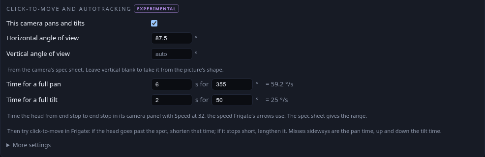

# Click-to-move and autotracking in Frigate

**English** · [Français](translations/autotracking.fr.md) · [Deutsch](translations/autotracking.de.md) · [Español](translations/autotracking.es.md) · [Nederlands](translations/autotracking.nl.md) · [Polski](translations/autotracking.pl.md) · [Português](translations/autotracking.pt.md)

> **Experimental.** Tested on a Reolink E1 Pro.

Frigate's click-to-move and autotracking need a camera that moves by part of the picture
(ONVIF relative moves, `TranslationSpaceFov`). Reolink heads can't, so Neolink.NET's PTZ
endpoint advertises it and does the work:

- **Pan and tilt** are timed from the lens's angle of view and how fast the head turns.
- **Start-up lag** is learned by itself on cameras that report their head position.
- **Zoom lenses** also take exact zoom positions.

## 1. Neolink.NET

**Server settings → Cameras → Edit** the camera:

1. Under *External connection*, set **PTZ for Frigate** to **Shared port**.
2. Under *Click-to-move and autotracking*, tick **This camera pans and tilts**.
3. Enter the lens's horizontal angle from its spec sheet.
4. Time a full pan and a full tilt (end stop to end stop, Speed 32 in the camera panel).
5. Save, then restart Neolink.NET.



*Reolink E1 Pro: 87.5°, a full pan in 6 s for 355°, a full tilt in 2 s for 50°.*

**Editing `config.json` instead?** Add these to the camera's entry. Rates are degrees ÷ seconds.

```jsonc
{
  "name": "e1pro",
  "address": "192.168.1.60",
  "username": "admin",
  "password": "…",
  "ptz_share": true,       // PTZ for Frigate on the shared port (8656)
  "ptz_fov_h": 87.5,       // required: horizontal lens angle, from the spec sheet
  "ptz_pan_rate": 59.2,    // required: °/s panning, 355° in 6 s
  "ptz_tilt_rate": 25      // °/s tilting, 50° in 2 s (default: the pan rate)
  // Optional: "ptz_fov_v" (vertical angle), "ptz_speed" (speed timed at, default 32),
  // "ptz_lag_ms" (motor start-up, learned if left out), "ptz_tele_fov_h" (zoom lenses: angle at full zoom)
}
```

## 2. Frigate

In the Reolink app, save a preset named `home` for the camera to return to.
Then add this to Frigate's config. Replace `e1pro` with the camera's name in Neolink.NET, and give an RTSP user that is allowed on it.

```yaml
go2rtc:
  streams:
    e1pro:
      - rtsp://<user>:<password>@<neolink-host>:8654/e1pro/mainStream
    e1pro_sub:
      - rtsp://<user>:<password>@<neolink-host>:8654/e1pro/subStream

cameras:
  e1pro:
    ffmpeg:
      inputs:
        - path: rtsp://127.0.0.1:8554/e1pro
          input_args: preset-rtsp-restream
          roles: [record]
        - path: rtsp://127.0.0.1:8554/e1pro_sub
          input_args: preset-rtsp-restream
          roles: [detect]
    detect:
      enabled: true
      fps: 5
    zones:
      tracking_area:
        coordinates: 0,0,1,0,1,1,0,1   # the whole picture
    onvif:
      host: <neolink-host>
      port: 8656
      user: <user>
      password: <password>
      profile: e1pro
      autotracking:
        enabled: true
        calibrate_on_startup: true   # set back to false after the first run
        zooming: disabled
        track: [person]
        required_zones: [tracking_area]
        return_preset: home
        timeout: 10
```

## 3. Test

1. **Click-to-move:** in Frigate's live view, click a spot. The head should centre on it.
   - If it goes past the spot, shorten that axis's time in Neolink.NET.
   - If it stops short, lengthen it.
   - In `config.json`, the other way round: raise the rate if it goes past, lower it if it stops short.
2. **Calibrate:** restart Frigate and leave the camera alone for about two minutes.
   Frigate saves `movement_weights` itself; then set `calibrate_on_startup: false`.
3. **Track:** walk into view. The camera follows you and returns to `home` after `timeout` seconds.

Autotracking needs a fast detector (Coral, OpenVINO or a GPU). A motion mask over the camera's timestamp helps.
Using Frigate 0.17 or older? Set **PTZ for Frigate** to **Own port** and use that port instead of 8656.
